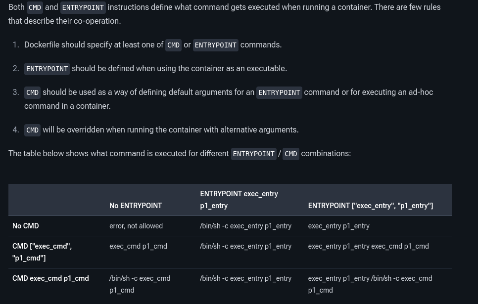

# 1. Instructions

ADD - Quando copiando um tar.gz, ele descompacta automaticamente se a copia for local, se for da internet nao descompacta
COPY
WORKDIR  Workdir tb é o local onde vai ser o diretório inicial ao executar o container 
Sets the working directory for any RUN, CMD, ENTRYPOINT, COPY, and ADD instructions that follow it in the Dockerfile
ARG - ARG is the only instruction that may precede FROM in the Dockerfile
ARG  CODE_VERSION=latest
FROM base:${CODE_VERSION}
CMD  /code/run-app

FROM extras:${CODE_VERSION}
CMD  /code/run-extras

ENTRYPOINT é o principal processos
CMD são os parâmetros do entrypoint, quando se tem ele
Da pra usar só o CMD sozinho, mas o correto é com entrypoint 
Lets you define the default program that is run once you start the container based on this image. Each Dockerfile only has one CMD, and only the last CMD instance is respected when multiple exist.

# CMD ou ENTRYPOINT no modo shell e exec
exec form - https://docs.docker.com/reference/dockerfile/#exec-form
Dockerfile should specify at least one of CMD or ENTRYPOINT commands.
The exec form is parsed as a JSON array, 
shell form - a regular string
. The shell form string lets you escape newlines using the escape character (backslash by default) to continue a single instruction onto the next line. This makes it easier to use with longer commands, because it lets you split them up into multiple lines. For example, consider these two lines:
RUN source $HOME/.bashrc && \
echo $HOME

RUN source $HOME/.bashrc && echo $HOME

CMD should rarely be used in the manner of CMD ["param", "param"] in conjunction with ENTRYPOINT, unless you and your expected users are already quite familiar with how ENTRYPOINT works.
CMD ["executable","param1","param2"] (exec form)
CMD ["param1","param2"] (exec form, as default parameters to ENTRYPOINT)
CMD command param1 param2 (shell form)

### entrypoint - 
https://docs.docker.com/reference/dockerfile/#exec-form-entrypoint-example  
https://docs.docker.com/reference/dockerfile/#understand-how-cmd-and-entrypoint-interact

If you would like your container to run the same executable every time, then you should consider using ENTRYPOINT in combination with CMD. See ENTRYPOINT. If the user specifies arguments to docker run then they will override the default specified in CMD, but still use the default ENTRYPOINT.   

You can specify a plain string for the ENTRYPOINT and it will execute in /bin/sh -c. 

When combining exec form ENTRYPOINT with CMD, use the exec form of CMD as well. Using the shell form of CMD causes it to be wrapped in /bin/sh -c, which means the ENTRYPOINT receives a shell invocation as its argument rather than the bare command and parameters. 

# 2. Layers
CoW
- ideia: nunca alterar o original, sempre uma cópia
- principal objetivo:  permitir o compartilhamento de camadas base
- Não é exclusivo do docker, vem do ZFS, Btrfs, snapshots de VM, já vi isso tb no livro  intensive data apps
- implementado pelo storage driver configurado no daemon, os mais comuns sao overlay2(padrao), devicemapper e btrfs
- overlay2 usa o sist de arquivos overlayFS do kernel pra empilhar camadas
- Layers are read-only
- 

docker image ls mostra o tamanho geral
docker history --human app:1.0 << entender aqui pra ver se vale a pena mostrar
    mostra a camada de 200MB sendo removida
O comando docker history mostra o histórico de construção de uma imagem Docker, incluindo as instruções utilizadas e o tamanho que cada uma adicionou à imagem.

No seu caso, ele é especialmente útil para demonstrar que as camadas de uma imagem são Read-Only (RO).
#### tem mais detalhes no chatGPT

Daqui pra baixo, vou diminuindo o tamanho da img

mudar pra go-lang menor, atualmente usa 1.3GB

# Multi-stage

With multi-stage builds, you use multiple FROM statements in your Dockerfile. Each FROM instruction can use a different base, and each of them begins a new stage of the build. You can selectively copy artifacts from one stage to another, leaving behind everything you don't want in the final image.

# Differences between legacy builder and BuildKit

The legacy Docker Engine builder processes all stages of a Dockerfile leading up to the selected --target. It will build a stage even if the selected target doesn't depend on that stage.

BuildKit only builds the stages that the target stage depends on.

For example, given the following Dockerfile:

https://docs.docker.com/build/building/multi-stage/#differences-between-legacy-builder-and-buildkit

# Best practices  - https://docs.docker.com/build/building/best-practices/

https://docs.docker.com/build/building/best-practices/#create-reusable-stages

https://docs.docker.com/build/building/best-practices/#rebuild-your-images-often
usar o --pull e --no-cache
usar o .gitignore
- don't install unnecessary packages
- sort multi-line arguments alphanumerically to make maintenance easier
- tag your images