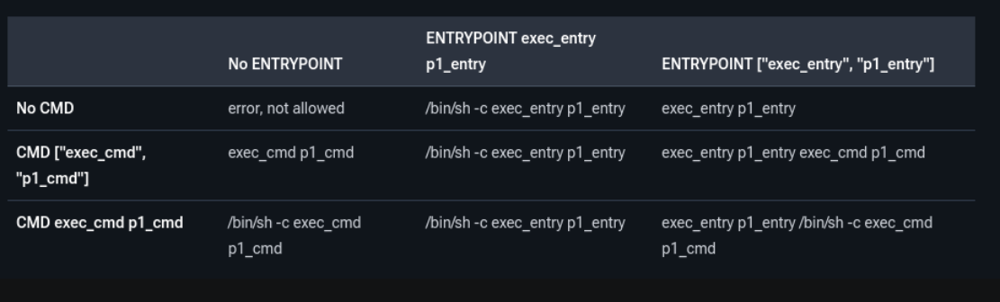

b# Dockerfile essentials

The examples use the Go app in [`./app`](./app/main.go) and different Dockerfiles to show how instructions affect the final image.


# Common Dockerfile instructions

- `FROM` selects the base image and starts a build stage.
- `ARG` defines a build-time variable. It is the only instruction allowed before the first `FROM`. Also worth mentioning that it's scopped.
- `RUN` executes a command while building the image and saves the filesystem changes.
- `COPY` copies files from the build context or another stage into the image.
- `ADD` also copies files, and can fetch a URL or unpack a local tar archive. A tar archive fetched from a URL is not unpacked automatically.
- `ENV` sets an environment variable that remains available in the built image and its containers.
- `WORKDIR` sets the directory for later instructions and the container's starting working directory.
- `CMD` sets the default command or default arguments for `ENTRYPOINT`. `docker run` arguments can replace it; only the last `CMD` takes effect.
- `ENTRYPOINT` sets the executable run when the container starts. With exec-form `ENTRYPOINT`, `CMD` can supply its default arguments.


## Build arguments

Build arguments are variables for the Dockerfile itself. Use them to parameterize values of Dockerfile instructions.
In Docker Build, build arguments (ARG) and environment variables (ENV) both serve as a means to pass information into the build process. You can use them to parameterize the build, allowing for more flexible and configurable builds.

Example [`1.arg`](./1.arg):
```shell
docker build --build-arg NAME=paulao -t app:arg.1 -f 1.arg .
```

## CMD vs ENTRYPOINT


- `CMD` supplies the default command when used alone. 
- With an exec-form `ENTRYPOINT`, it supplies default arguments to that executable. 
- Arguments after the image name in `docker run` replace `CMD`; the `ENTRYPOINT` still runs.  
- Shell form (`CMD echo hello`) runs through a shell and does not pass arguments to an exec-form `ENTRYPOINT` the same way.

The two stages in [`2.cmd_entrypoint`](./2.cmd_entrypoint) show both cases:

1. CMD only
```shell
docker build -f 2.cmd_entrypoint --target cmd_only -t demo:cmd .
```
```shell
docker run --rm demo:cmd

docker run --rm demo:cmd echo replacement
```

2. ENTRYPOINT + CMD

```shell
docker build -f 2.cmd_entrypoint -t demo:entrypoint .
```
```shell
docker run --rm demo:entrypoint

docker run --rm demo:entrypoint coisola
```

## Shell vs Exec mode

Exec form starts the program directly as the container's main process (PID 1). It receives stop signals, and Kubernetes reports its exit code.

```dockerfile
CMD ["echo", "hello"]
```

Shell form starts `/bin/sh -c` to run the command. If the shell remains as PID 1, it receives stop signals instead of the app, and Kubernetes reports the shell's exit code. The shell may not forward signals or preserve the app's exit code.

```dockerfile
CMD echo hello
```

# Image Layers and copy-on-write (CoW)

Images are read-only.

Filesystem changes made by instructions such as `COPY` and `RUN` are stored in image layers. Once created, those layers are read-only. A running container sees them as one filesystem and gets its own writable layer. When the container changes a file from the image, the changed version is recorded in its writable layer; the original remains available to other containers. This is *copy-on-write* (CoW). Sharing the base avoids duplicating it for every container, and starting a container does not require copying the entire image first.

### How does layers work

Let's create a 200 MB temporary file inside the image and then remove it:

[3.layers_1](./3.layers_1)  Creates the 200MB file and then removes it. Let's build and check the image size.

```shell
docker build -f 3.layers_1 -t dockerfile-layers-1 .
```
```shell
docker image ls 

docker run --rm dockerfile-layers-1 ls -lhart /tmp

docker history dockerfile-layers-1
```

[3.layers_2](./3.layers_2)  do the same thing but instead of a new `RUN` instruction, it adds the `rm` command in the same instruction.
```shell
docker build -f 3.layers_2 -t dockerfile-layers-2 .
```
```shell
docker image ls 

docker history dockerfile-layers-2
```

The first `RUN` commits the 200 MB file. The second hides it from the final filesystem, but cannot rewrite the earlier layer. The image is therefore roughly 200 MB larger, even though `/tmp/arquivo.bin` is absent when a container starts.

# Multi-stage build

[`4.multi_stage`](./4.multi_stage) uses the same Go source and `/app/hello` output, then starts a small final stage:

The important operation is `COPY --from=build`: it transfers the finished executable from the `build` stage into the final stage. The Go compiler, source files, and other builder files are not part of the final image. `CGO_ENABLED=0` makes this small Go program independent of the builder's C libraries, so it can run on the Alpine base.

```bash
docker build -f 4.multi_stage -t dockerfile-multistage .
```

## References
- https://docs.docker.com/reference/dockerfile/#understand-how-cmd-and-entrypoint-interact
- https://docs.docker.com/build/building/variables/#build-arguments
- https://docs.docker.com/get-started/docker-concepts/building-images/understanding-image-layers/
- https://docs.docker.com/build/building/variables/
- [Dockerfile reference](https://docs.docker.com/reference/dockerfile/)
- [Image layers and copy-on-write](https://docs.docker.com/engine/storage/drivers/)
- [Multi-stage builds](https://docs.docker.com/build/building/multi-stage/)
